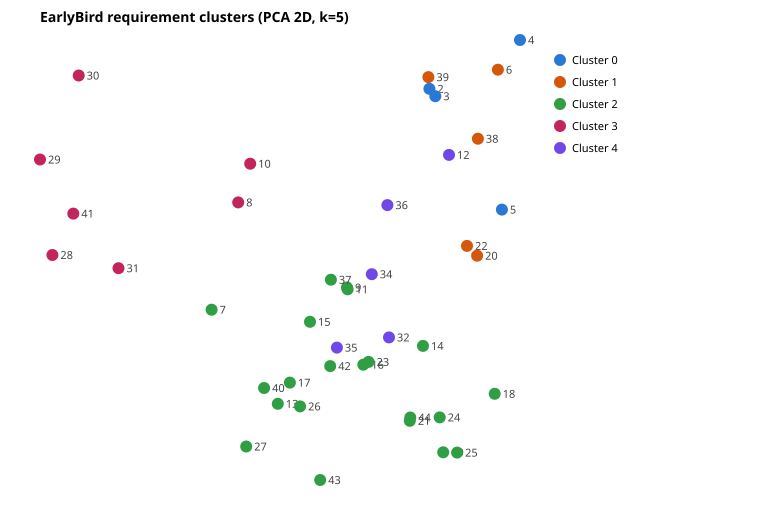

# ArchitectureDevelopment02 – Embedding-Ansatz für «EarlyBird»

Home Exercise (ExID: ArchitectureDevelopment02): Die funktionalen Anforderungen von «EarlyBird» (Requirements V1.50) werden
eingebettet, in einer Vektordatenbank gespeichert und **von der Datenbank geclustert**. Jeder Cluster ist ein Vorschlag für eine
Komponente des Application Core.

## Ausführen

```bash
npm install
npm start        # node src/cluster.mjs
```

Beim ersten Lauf wird das Embedding-Modell (~90 MB) einmalig von Hugging Face geladen. Danach läuft alles lokal, ein API-Key ist nicht nötig.

## Pipeline

| Schritt | Umsetzung |
|---|---|
| Anforderungen | [data/requirements.json](data/requirements.json): 42 funktionale Anforderungen (Rq 2–32, 34–44) |
| Embeddings | `Xenova/all-MiniLM-L6-v2` (384 Dimensionen, Mean-Pooling, normalisiert) via transformers.js |
| Vektordatenbank | DuckDB, Datei `vectordb/earlybird.duckdb`, Spalte `embedding FLOAT[384]` |
| Clustering | k-means **als SQL in DuckDB**: k-means++-Initialisierung, Zuordnung per `array_cosine_distance`, Zentroid-Update per `avg`. 30 Restarts je k, beste Inertia gewinnt. JavaScript steuert nur die Iterationen. |
| Wahl von k | k ∈ [4, 8], höchster Silhouette-Score (ebenfalls in SQL berechnet) |
| Repräsentanten | Vektorsuche in der DB: die 3 Anforderungen, die dem Cluster-Zentroid am nächsten liegen |
| Namen | Von Hand in [data/cluster-names.json](data/cluster-names.json). Als Hilfe gibt es TF-IDF-Keywords je Cluster. |

### Tabellen in `vectordb/earlybird.duckdb`

| Tabelle | Inhalt |
|---|---|
| `requirements` | `id`, `text`, `embedding` |
| `requirement_clusters` | `id` → `cluster` (Endergebnis) |
| `clusters` | `cluster`, `centroid` |
| `kmeans_runs` | alle Läufe: `k`, `restart`, `iterations`, `inertia`, `silhouette` |

Ausgaben in `output/`: `clusters.json` (Ergebnis), `clusters.svg` (2D-PCA-Plot), `embeddings.json`.

## Ergebnis (k = 5)

Silhouette je k: 4 → 0.129, **5 → 0.172**, 6 → 0.160, 7 → 0.152, 8 → 0.141

| Cluster | Name | Rq | Repräsentanten | Keywords |
|---|---|---|---|---|
| 0 | *offen* | 2, 3, 4, 5 | 3, 5, 2 | prepackaged, breakfast, croissant, simple, coffee, various |
| 1 | *offen* | 6, 20, 22, 38, 39 | 38, 22, 6 | unit, product, label, grams, price, per |
| 2 | *offen* | 7, 9, 11, 13–19, 21, 23–27, 37, 40, 42, 43, 44 | 27, 13, 19 | clerk, payment, system, number, delivery, address |
| 3 | *offen* | 8, 10, 28, 29, 30, 31, 41 | 28, 29, 41 | possible, canceling, message, number, call, collective |
| 4 | *offen* | 12, 32, 34, 35, 36 | 36, 35, 32 | clerks, replaces, browser, based, less, current |



## Clusternamen eintragen

1. Trage in [data/cluster-names.json](data/cluster-names.json) für jeden Cluster `name` und `description` ein.
2. Führe `npm start` erneut aus. Die Namen erscheinen dann in `output/clusters.json` und in der Legende von `output/clusters.svg`.

Das Clustering ist deterministisch (feste Seeds, 1 Thread), die Clusternummern bleiben also gleich.
